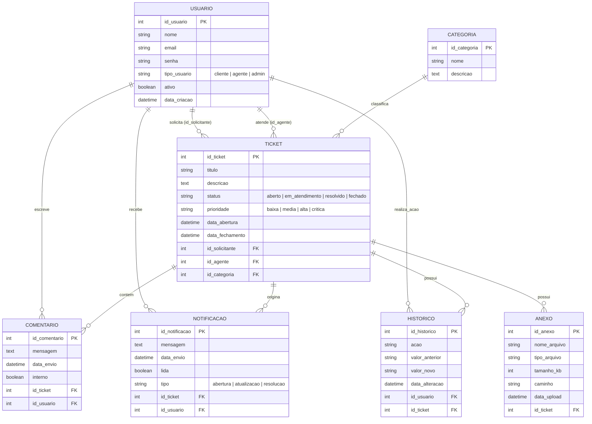

# 🎧 HelpTicket — Sistema de Registro e Gestão de Incidentes em TI

> Sistema web moderno para formalização, centralização e acompanhamento inteligente de chamados de suporte técnico em TI para pequenas e médias organizações.

---

## 📌 Sumário

- [Sobre o Projeto](#-sobre-o-projeto)
  - [Contexto Acadêmico](#-contexto-acadêmico)
  - [O Problema](#-o-problema)
  - [A Solução](#-a-solução)
- [Funcionalidades Principais](#-funcionalidades-principais)
- [Perfis de Acesso (RBAC)](#-perfis-de-acesso-rbac)
- [Stack Tecnológica](#-stack-tecnológica)
- [Arquitetura do Sistema](#-arquitetura-do-sistema)
- [Modelagem de Dados (MER/DER)](#-modelagem-de-dados-merder)
- [Endpoints da API (Backend C#)](#-endpoints-da-api-backend-c)
- [Protótipo de Interface](#-protótipo-de-interface)
- [Estrutura do Repositório](#-estrutura-do-repositório)
- [Como Executar o Projeto](#-como-executar-o-projeto)
  - [Pré-requisitos](#pré-requisitos)
  - [1. Backend (C# / .NET Web API)](#1-backend-c--net-web-api)
  - [2. Frontend (React 19 + Vite)](#2-frontend-react-19--vite)
  - [Credenciais Padrão para Teste](#-credenciais-padrão-para-teste)
- [Testes Automatizados](#-testes-automatizados)
  - [Backend (xUnit)](#backend-xunit)
  - [Frontend (Vitest)](#frontend-vitest)
- [Metodologia e Processo](#-metodologia-e-processo)
---

## 📖 Sobre o Projeto

### 🎓 Contexto Acadêmico
O **HelpTicket** é um projeto concebido e desenvolvido no âmbito da disciplina de **Engenharia de Software I** do curso de **Bacharelado em Sistemas de Informação** do **Instituto Federal do Ceará (IFCE) – Campus Crato**.

- **Orientador:** Prof. Me. Alexandre de Sá Carneiro Wanderley

### ⚠️ O Problema
Em muitas pequenas e médias empresas, as solicitações e incidentes de TI ainda são tratados por canais informais (mensagens no WhatsApp, conversas verbais ou e-mails dispersos). Esse cenário provoca:
- **Perda de histórico** e ausência de rastreabilidade das ações aplicadas;
- **Dificuldade na identificação de gargalos** e falhas recorrentes de infraestrutura/software;
- **Ausência de controle de SLA** (Service Level Agreement - tempos de resposta e resolução);
- **Sobrecarga desordenada** e falta de priorização para a equipe técnica.

### 💡 A Solução
O **HelpTicket** centraliza, padroniza e automatiza a gestão do suporte técnico:
1. **Padronização:** Abertura estruturada de chamados com classificação por categoria e criticidade;
2. **Distribuição e Gestão:** Fila organizada de tickets com atribuição de técnicos e controle de status;
3. **Auditoria e Transparência:** Registro de histórico de alterações e comentários (públicos e notas internas);
4. **Inteligência Gerencial:** Métricas de desempenho, controle de SLA e relatórios de problemas mais recorrentes.

---

## ✨ Funcionalidades Principais

- **RF01 — Autenticação e Gestão de Usuários:** Autenticação via JWT (JSON Web Token), criptografia de senhas com `IPasswordHasher` e controle de permissões por perfil (Cliente, Agente/Técnico e Administrador).
- **RF02 — Abertura de Chamados:** Registro de tickets com título, descrição, categoria, anexos/evidências e prioridade (Baixa, Média, Alta, Crítica).
- **RF03 — Atendimento e Gestão do Ciclo de Vida:**
  - Ciclo de status: `Aberto` ➔ `Em Atendimento` ➔ `Resolvido` ➔ `Fechado`.
  - Atribuição automática e manual de técnicos.
  - Registro da solução aplicada e encerramento com timestamp.
  - Comentários no ticket (públicos para interação com o cliente ou internos exclusivos para a equipe técnica).
  - Tabela de auditoria/histórico registrando todas as alterações de valores e seus autores.
- **RF04 — Notificações e Alertas:** Registro de notificações enviadas a usuários sobre novos eventos nos chamados.
- **RF05 — Relatórios e Dashboards:**
  - Painel administrativo com volume de chamados e tempos médios;
  - Painel individual do técnico com sua fila de trabalho;
  - Relatório analítico apontando os incidentes mais recorrentes na organização.

---

## 👥 Perfis de Acesso (RBAC)

| Perfil | Descrição e Atribuições |
| :--- | :--- |
| **Cliente (Solicitante)** | Abre novos chamados, envia anexos, acompanha o status das suas solicitações, interage em comentários públicos e recebe notificações. |
| **Agente (Técnico)** | Visualiza a fila de chamados, assume ou transfere tickets, altera status, registra soluções técnicas e insere notas internas ou respostas ao cliente. |
| **Administrador** | Gestão global do sistema, gerenciamento de usuários e níveis de acesso, cadastro de categorias, visualização de logs de auditoria e relatórios executivos. |

---

## 🛠 Stack Tecnológica

### Frontend
- **Framework & Ferramentas:** [React 19](https://react.dev/) + [Vite](https://vite.dev/)
- **Estilização:** Vanilla CSS modular (Design System próprio, responsivo, tokens de cores e microanimações)
- **Ícones:** [Lucide React](https://lucide.dev/)
- **Gerenciador de Pacotes:** [pnpm](https://pnpm.io/) (ou npm)

### Backend
- **Linguagem & Framework:** **C#** no ecossistema **[.NET / ASP.NET Core Web API](https://dotnet.microsoft.com/)**
- **Arquitetura:** Padrão em camadas (Controllers ➔ Services ➔ Repositories ➔ Models / DTOs)
- **ORM / Persistência:** [Entity Framework Core](https://learn.microsoft.com/ef/core/) (com suporte a banco em memória para desenvolvimento e banco relacional para produção)
- **Segurança & Criptografia:** Autenticação via **JWT (Bearer Token)** e hash de senhas com `Microsoft.AspNetCore.Identity.PasswordHasher`
- **Documentação da API:** OpenAPI / Swagger (`MapOpenApi`)

### Banco de Dados & Infraestrutura
- **SGBD:** [PostgreSQL](https://www.postgresql.org/) (via [Npgsql Entity Framework Core](https://www.npgsql.org/efcore/))
- **Versionamento:** [Git](https://git-scm.com/) e [GitHub](https://github.com/)
- **Prototipação:** [Figma](https://www.figma.com/)

---

## 🏛 Arquitetura do Sistema

O sistema é construído sobre o desacoplamento cliente-servidor através de uma API RESTful:

```
                      ┌────────────────────────────────────────┐
                      │          Frontend (React 19)           │
                      │   Screens ─ Modules ─ Controllers ─ UI │
                      └──────────────────┬─────────────────────┘
                                         │  HTTPS / REST (JSON + JWT)
                                         ▼
                      ┌────────────────────────────────────────┐
                      │       Backend (.NET / C# Web API)      │
                      │  Controllers ─ Services ─ Repositories │
                      └──────────────────┬─────────────────────┘
                                         │  Entity Framework Core
                                         ▼
                      ┌────────────────────────────────────────┐
                      │             Banco de Dados             │
                      │              (PostgreSQL)              │
                      └────────────────────────────────────────┘
```

---

## 🗄 Modelagem de Dados (MER/DER)

A modelagem de dados documentada no plano de software compreende as seguintes 7 entidades fundamentais:



---

## 🔌 Endpoints da API (Backend C#)

### Autenticação (`/api/auth`)
| Método | Rota | Descrição | Autenticação |
| :--- | :--- | :--- | :--- |
| `POST` | `/api/auth/login` | Realiza autenticação com e-mail e senha, retornando token JWT e dados do usuário | Pública |

### Chamados (`/api/tickets`)
| Método | Rota | Descrição | Autenticação |
| :--- | :--- | :--- | :--- |
| `POST` | `/api/tickets` | Cria um novo chamado no sistema | `Bearer JWT` |
| `GET` | `/api/tickets` | Lista chamados cadastrados | `Bearer JWT` |
| `GET` | `/api/tickets/{id}` | Obtém detalhes completos de um chamado específico | `Bearer JWT` |

---

## 🎨 Protótipo de Interface

O protótipo de alta fidelidade de todas as telas foi projetado no Figma:

- 🔗 **[Visualizar Protótipo Interativo no Figma](https://www.figma.com/proto/6i1mCkoXxZuyIIOMpU5XCD/Engenharia-de-Software--HelpTicket--Copy-?node-id=6-3&t=zYCPH7v8kvQkPqEz-1&scaling=min-zoom&content-scaling=fixed&page-id=0%3A1&starting-point-node-id=6%3A3&show-proto-sidebar=1)**

### Telas Mapeadas:
1. **Tela de Login / Autenticação**
2. **Home / Visão Geral**
3. **Abertura de Novo Chamado**
4. **Fila de Chamados (com filtros por status e prioridade)**
5. **Detalhes e Tratamento do Chamado**
6. **Gerenciamento de Categorias de Incidentes**
7. **Gerenciamento de Usuários e Perfis**
8. **Dashboard Administrativo**
9. **Dashboard do Técnico**
10. **Visão Geral de Desempenho e Relatórios**
11. **Perfil e Configurações do Usuário**

---

## 📁 Estrutura do Repositório

```bash
helpticket/
├── docs/                                   # Plano de projeto de software (PDF) e documentação
│   └── HELPTICKET_...pdf
├── backend/                                # Backend em C# (.NET Web API)
│   └── HelpTicket.Api/
│       ├── Controllers/                    # Controllers REST (AuthController, TicketsController)
│       ├── Services/                       # Regras de negócio (AuthService, TicketService)
│       ├── Repositories/                   # Acesso a dados (UsuarioRepository, TicketRepository)
│       ├── Data/                           # DbContext, Migrations e DbInitializer
│       ├── Models/                         # Entidades de domínio (Usuario, Ticket)
│       ├── DTOs/                           # Data Transfer Objects para requests e responses
│       ├── Program.cs                      # Configuração da pipeline, DI e JWT
│       └── appsettings.json
│   └── HelpTicket.Tests/                   # Testes automatizados do backend (xUnit + EF Core InMemory)
│       ├── Helpers/TestDbFactory.cs        # Banco em memória isolado + cenário de dados
│       └── Services/                       # AuthServiceTests, TicketServiceTests
├── frontend/                               # Frontend SPA em React 19 + Vite
│   ├── src/
│   │   ├── config/                         # Configuração de conexão com a API
│   │   ├── modules/
│   │   │   └── auth/                       # Telas, controladores e modelos de login
│   │   ├── shared/                         # Componentes reutilizáveis (Field, Banner, etc.)
│   │   ├── App.jsx
│   │   ├── main.jsx
│   │   └── index.css                       # Design System e estilos globais
│   ├── index.html
│   ├── package.json
│   └── vite.config.js
├── HelpTicket.slnx                         # Arquivo de solução .NET
├── .gitignore                              # Regras de ignorados do Git na raiz
└── README.md                               # Documentação oficial do projeto
```

---

## 🚀 Como Executar o Projeto

### Pré-requisitos
- [.NET SDK 8.0+](https://dotnet.microsoft.com/download) (ou .NET 10)
- [PostgreSQL 15+](https://www.postgresql.org/download/)
- [Node.js](https://nodejs.org/) (versão 20+ recomendada)
- [pnpm](https://pnpm.io/) (`npm install -g pnpm`)

---

### 1. Backend (C# / .NET Web API)

1. Entre na pasta da API:
   ```bash
   cd backend/HelpTicket.Api
   ```

2. Configure a string de conexão do PostgreSQL e a chave do JWT:
   ```bash
   dotnet user-secrets set "ConnectionStrings:DefaultConnection" "Host=localhost;Port=5432;Database=helpticket;Username=postgres;Password=suasenha"
   dotnet user-secrets set "Jwt:Key" "SuaChaveSuperSecretaComMaisDe32CaracteresAqui!"
   ```
   *(Ou declare as chaves no `appsettings.Development.json`)*.

3. Restaure as dependências e aplique as migrações:
   ```bash
   dotnet ef database update
   ```

4. Inicie a API:
   ```bash
   dotnet run
   ```

A API iniciará por padrão em `https://localhost:5001` (ou `http://localhost:5000`).

---

### 2. Frontend (React 19 + Vite)

1. Em outro terminal, acesse a pasta do frontend:
   ```bash
   cd frontend
   ```

2. Instale as dependências:
   ```bash
   pnpm install
   ```

3. Inicie o servidor de desenvolvimento:
   ```bash
   pnpm run dev
   ```

Acesse a interface no navegador em: `http://localhost:5173`.

---

### 🔑 Credenciais Padrão para Teste

Ao iniciar o backend pela primeira vez, o `DbInitializer` cria automaticamente o seguinte usuário de teste:

- **E-mail:** `usuario@helpticket.com`
- **Senha:** `123456`
- **Perfil:** `Usuario`

---

## 🧪 Testes Automatizados

O projeto possui testes automatizados no **backend** e no **frontend**, cobrindo as principais regras de negócio descritas nos requisitos funcionais (RF01 a RF05) e no controle de acesso (RBAC).

### Backend (xUnit)

- **Framework:** [xUnit](https://xunit.net/) + `Microsoft.NET.Test.Sdk`
- **Banco de dados:** `EntityFrameworkCore.InMemory` — cada teste cria um banco isolado (`Guid` único), sem depender de PostgreSQL.
- **Projeto:** `backend/HelpTicket.Tests` (já incluído no `HelpTicket.slnx`)

**Executar:**

```bash
# na raiz do repositório
dotnet test

# ou apenas o projeto de testes
dotnet test backend/HelpTicket.Tests

# com relatório de cobertura (coverlet)
dotnet test --collect:"XPlat Code Coverage"
```

**O que é testado:**

| Suíte | Requisito | Cenários cobertos |
| :--- | :--- | :--- |
| `AuthServiceTests` | RF01 — Autenticação | Login válido retorna JWT e dados do usuário; token contém *issuer*, *audience*, e-mail e perfil; senha incorreta, e-mail inexistente e usuário inativo são rejeitados |
| `TicketServiceTests` › Abertura | RF02 — Abertura de chamados | Chamado nasce com status `Aberto` e sem agente; categoria inexistente ou inativa é rejeitada |
| `TicketServiceTests` › Listagem | RBAC | Solicitante vê apenas os próprios chamados; agente vê os atribuídos a ele; filtro por status; busca sem diferenciar maiúsculas; paginação |
| `TicketServiceTests` › Ciclo de vida | RF03 — Atendimento | `Resolvido` registra `DataResolucao`; `Fechado` registra `DataFechamento`; atribuir agente a chamado `Aberto` muda para `EmAtendimento`; chamado já resolvido mantém o status |
| `TicketServiceTests` › Comentários | RF03 / RF04 | Comentário do agente notifica o solicitante e vice-versa; comentário aparece no detalhe do chamado; chamado inexistente retorna `null` |
| `TicketServiceTests` › Anexos | RF02 | Anexos ficam vinculados ao chamado |
| `TicketServiceTests` › Relatórios | RF05 — Dashboards | Totais por status; críticos ignoram chamados fechados; estatísticas filtradas por solicitante; agrupamento por categoria e últimos 7 dias |

### Frontend (Vitest)

- **Framework:** [Vitest](https://vitest.dev/) com ambiente `jsdom` (configurado em `frontend/vite.config.js`)
- **Convenção:** arquivos `*.test.js` / `*.test.jsx` ao lado do código testado

**Executar:**

```bash
cd frontend
pnpm install
pnpm test          # execução única (ideal para CI)
pnpm test:watch    # modo observação durante o desenvolvimento
```

**O que é testado:**

| Arquivo | Cenários cobertos |
| :--- | :--- |
| `src/modules/auth/models/AuthModel.test.js` | Validação do formulário de login (campos obrigatórios, formato de e-mail, senha mínima) e chamada ao `/api/auth/login` com tratamento de erros 401/500 |
| `src/lib/api.test.js` | Envio do token JWT no header, montagem da *query string* de filtros, métodos HTTP corretos, tratamento de `204`, propagação de mensagens de erro e limpeza da sessão em `401` (token expirado) |
| `src/modules/tickets/utils/commentParser.test.js` | Detecção de imagens (MIME, extensão, Data URL), separação de imagem/anexo/texto nas mensagens do chamado e geração do Markdown de anexos |
| `src/shared/components/Badges.test.jsx` | Rótulos e cores do `StatusBadge` e `PriorityBadge` para todos os status/prioridades vindos da API |

> [!TIP]
> Rode `dotnet test` e `pnpm test` antes de abrir um Pull Request para garantir que nenhuma regra de negócio foi quebrada.

---

## 🔄 Metodologia e Processo

O projeto adota uma adaptação prática do **Scrum**:
- **Sprints semanais:** Ciclos curtos com metas bem definidas para entrega incremental de valor;
- **Dailies assíncronas:** Alinhamento diário via WhatsApp para identificação ágil de impedimentos;
- **Reuniões semanais:** Encontros remotos via Google Meet para Sprint Planning e Review;
- **Fluxo de versão Git:** Desenvolvimento baseado em branches de funcionalidade (`feature/...`), integrado à branch `main` via Pull Requests.

---

---

<p align="center">
  Desenvolvido com dedicação e boas práticas de Engenharia de Software • <b>IFCE Campus Crato 2026</b>
</p>
